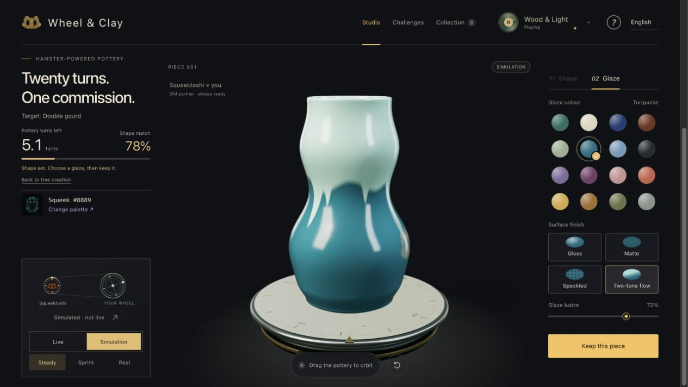

# Wheel & Clay

**His wheel. Your hands.**

A browser-based 3D pottery playground powered by Squeekchain. Shape the clay, choose a glaze, then let a settled hamster-wheel round leave its mark on the surface.

**English** · [简体中文](README.zh-CN.md)

[Play in your browser](https://wheel-and-clay.shop/) · [Download the demo · 41s MP4](https://github.com/ananaer/wheel-and-clay/raw/refs/heads/main/media/wheel-and-clay-intro.mp4) · [Changelog](CHANGELOG.md)

[](https://wheel-and-clay.shop/)

*The actual studio in Simulation mode. Desktop browser with WebGL required. Making, keeping and sharing a piece need no wallet or account.*

## Make something only you could make

- **Shape it by hand.** Hold the clay and gently push or pull. Choose a starting form, adjust your touch, and undo or redo. Keyboard and precision tools are available too.
- **Find a challenge.** Nine target forms, three challenge modes, and a golden silhouette to work toward.
- **Give it a finish.** Combine 16 glaze colours with gloss, matte, speckled or two-tone flow. Turn the piece to inspect its surface.
- **Fire it with a real round.** In the Hamster kiln, choose a settled Squeekchain round. Its work and data hash determine the glaze flow and kiln markings while preserving your chosen colour.
- **Keep the result.** Save a piece, download its card, or share its interactive 3D view. You can optionally mint a separate pottery NFT on Sepolia.

Four original soundscapes accompany the studio. The interface defaults to English and can switch to Chinese.

## Choose your pace

| Mode | What you do | When it ends |
| --- | --- | --- |
| Freeform studio | Start with a vase, column or bowl and make your own shape. | Whenever you are ready to glaze. |
| Open practice | Follow any of the nine target silhouettes. | No turn limit. |
| Twenty turns | Shape toward a target with a limited wheel budget. | Set the shape early, or use all 20 pottery-wheel turns. |
| Rescue a pot | Repair a local flaw while protecting the rest of the piece. | Set it early, or use all 12 turns; both repair and preservation matter. |

The turn budget belongs to the **virtual pottery wheel**. It is not a raw sensor count or an on-chain settlement. Scores are local; there is no online leaderboard.

## What the hamster actually changes

Squeektoshi's public wheel-speed data drives a reduced, smoothed pottery-wheel speed. That speed changes how quickly the clay responds and how quickly a challenge uses its turns. When available game power stops, the wheel coasts down and shaping pauses.

- **Live:** reads the public `GET https://api.squeekchain.com/v1/status` endpoint every eight seconds. After a valid running sample, a 90-second buffer prevents a brief zero reading or connection gap from abruptly interrupting a piece. Raw readings remain separate from buffered game power; missing data is never reported as a confirmed stop.
- **Simulation:** offers Steady, Sprint and Rest through the same game mechanics, with a visible simulation label. Rest takes effect without the Live buffer. A piece that used simulated power keeps that label.
- **First visit:** the landing demonstration starts with clearly labelled simulated power. While you are on the homepage, it may switch to fresh running hardware data. Entering the studio or choosing a source locks that choice for your session.

The homepage's shaping, glazing and laser-engraving sequence is a separate introduction. Laser engraving is not a player-operated studio tool.

## Shape → Glaze → Hamster kiln

The kiln reads real, settled rounds from Squeekchain on Sepolia. Pick a round, fire the glaze, and compare the original surface with the result. The same saved design and round always produce the same kiln recipe. Work controls its strength; the round and data hash determine its pattern. This is a reproducible creative choice, not a rarity draw.

Shaping power and kiln provenance are separate. A piece made in **Simulation** can use a real settled round for its kiln finish, and it keeps its Simulation label. A zero-work round means zero settled work; it does not prove the hamster was asleep. You can also keep the original glaze without firing it.

## Keep and share

Finish and collect your piece, then choose **Copy piece link**. The receiver can rotate the same 3D piece without replacing their current work.

- Up to 12 pieces are stored in the current browser. Clearing browser storage removes that local collection.
- A piece link carries its compact design and, when present, kiln recipe in the URL fragment. It does not upload an image or include a score, account or local identifier. Anyone with the link can view the design.
- Shared Live/Simulation labels describe the maker's session; they are not hardware attestations or ownership proofs.
- A shared kiln recipe is labelled **source unverified** until its provenance is checked. A design link does not create or prove an NFT.
- Image sharing depends on browser support. The X entry prepares text and a link; you attach the image and confirm posting yourself.

## Optional: mint your pottery

**Mint this piece** is an optional Sepolia ERC-721 transaction. Your wallet asks you to confirm it; gas is paid with Sepolia test ETH. The collection charges no mint fee. Ordinary firing, local collection and sharing remain available without a wallet.

The NFT freezes the complete 270-byte 3D design, the selected glaze and the round's work and data hash. Its on-chain metadata includes a **2D profile preview**; the website reconstructs the full 3D piece from contract data at `?nft=TOKEN_ID`. A verified NFT view shows its maker and current owner with explorer links. Stored local labels alone do not establish NFT ownership.

This is the independent **Wheel & Clay** pottery collection, not the official Squeeks collection. Choosing a historical round does not prove that the piece was made during that round. Squeekchain's source Core is upgradeable: source checks do not remove its governance trust. Once minted, a piece's frozen design and metadata are unaffected by later Core changes.

The [Sepolia collection contract](https://eth-sepolia.blockscout.com/address/0xf83b2c5dc0650ccfb0a621b68c9bbbbdf35f0cc9) is deployed, with its [deployment transaction](https://eth-sepolia.blockscout.com/tx/0x08cf183e47db2df884605eff980d8cb6607ef295589077af8c34b86cf948d133) and runtime checked. [NFT #1](https://wheel-and-clay.shop/?nft=1) was successfully [minted on Sepolia](https://eth-sepolia.blockscout.com/tx/0x79796966ff7532aead4e6e3a3acb9ea89e5bac1f70d0cda98547c6d3cd9bde52) and verified after 12 blocks: maker, owner, the full design, round 646 with work 514, and embedded metadata matched. See the [contract documentation](contracts/README.md) for the evidence, tests and trust boundaries.

## Run locally

Use Python 3 and a desktop browser with WebGL. No package installation is required.

```sh
git clone https://github.com/ananaer/wheel-and-clay.git
cd wheel-and-clay
python3 -m http.server 8000 --bind 127.0.0.1
```

Open [http://127.0.0.1:8000](http://127.0.0.1:8000). Live shaping needs the Squeekchain API; kiln rounds and NFT views need a Sepolia RPC connection. Simulation shaping and ordinary glazing can be played without API data. Locally created share links open the public site.

To create a self-contained HTML file and a source archive:

```sh
python3 build.py
```

This produces `Wheel-and-Clay.html` and `Wheel-and-Clay.zip`. These are generated outputs, not files supplied by a fresh clone.

For static hosting, run `python3 deploy/prepare_pages.py` after building. Deploy only `deploy/pages-site/`: its small HTML entry links to hashed CSS and JavaScript files and retains the Squeekchain project-verification tag. The standalone HTML is for offline distribution; it is not the production homepage. Run `python3 tests/test_pages_build.py` to check the packaging boundary.

### Development checks

The browser-logic tests run with Node.js 24, use local fixtures and need no wallet or live API:

```sh
for test in tests/test_*.cjs tests/test_*.mjs; do
  if [ "$test" = "tests/test_kiln_contract.mjs" ]; then continue; fi
  node "$test" || exit 1
done
```

Tests cover shaping, power, challenges, kiln recipes, source validation, sharing and the NFT client's transaction states using fixtures. The [contract tests](contracts/README.md#build-and-offline-tests) require separately prepared, pinned tools and execute real bytecode in a local EVM; they do not send transactions to Sepolia. Browser interaction and motion review remain separate checks; see [QUALITY.md](QUALITY.md).

### Project map

| File | Responsibility |
| --- | --- |
| `core.js` / `engine.js` | API normalization, shaping, transmission, power buffering and scoring |
| `scene.js` / `glazes.js` | Three.js geometry, materials and interaction |
| `app.js` / `orders.js` | Studio state and challenge flows |
| `home.js` / `craft-demo.js` / `engraving.js` | Homepage introduction |
| `share.js` / `piece-link.js` | Cards and portable 3D piece links |
| `kiln-art.js` / `kiln-chain.js` / `kiln-view.js` | Deterministic kiln finish, settled-round reads and firing flow |
| `nft-client.js` / `contracts/` | Optional Sepolia minting, verified NFT reads and frozen artwork |
| `audio.js` / `activity.js` | Original procedural sound and page activity |
| `build.py` / `deploy/` | Standalone build and static-hosting preparation |

## Credits and project status

An independent Squeekchain community project. Pottery, scores and cards are created in the browser. Only the optional NFT action requests a wallet transaction; ordinary play does not register a work on-chain. The new contract and renderer have not undergone a third-party security audit.

- Official Squeekchain marks and three Sepolia Squeek samples are documented in [BRAND-ASSETS.md](BRAND-ASSETS.md). Palette inspiration does not imply NFT ownership or official endorsement.
- Three.js is bundled locally with its [MIT license](vendor/THREE-LICENSE.txt).
- This repository does not currently specify a project-wide license.

Found a bug or have a game idea? [Open an issue](https://github.com/ananaer/wheel-and-clay/issues).

## Project verification

squeekchain-project: 1453297a-e446-4298-a8dd-a46da2c48e94
