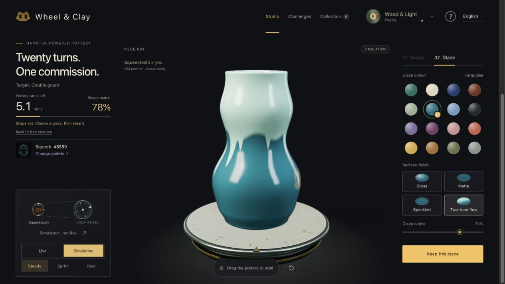

# Wheel & Clay

**它来跑轮，你来拉坯。**

由 Squeekchain 驱动的浏览器三维陶艺游戏。一只真实仓鼠决定节奏，你来赋予陶土形状。

**简体中文** · [English](README.md)

[立即试玩](https://wheel-and-clay.shop/) · [下载演示 · 41 秒 MP4](https://github.com/ananaer/wheel-and-clay/raw/refs/heads/main/media/wheel-and-clay-intro.mp4) · [更新记录](CHANGELOG.md)

[](https://wheel-and-clay.shop/)

*实际工作室画面，使用模拟动力。需要支持 WebGL 的桌面浏览器，无需钱包或账号。*

## 做一件只属于你的作品

- **亲手拉坯。** 按住陶器，轻轻向内推或向外拉。选择起形、调整指腹宽度，也可以撤销或重做。另有键盘操作和精细塑形工具。
- **接一份挑战。** 九种目标器形、三种挑战模式，金色轮廓为你提供参照。
- **选一层釉。** 16 种釉色可搭配光釉、哑釉、细斑釉或双色流釉。转动作品，看看表面的变化。
- **把作品传出去。** 收藏陶器、下载作品卡，或复制链接，让别人打开同样器形与釉色的互动三维作品。

工作室配有四首原创音景。界面默认英文，可切换为中文。

## 选择你的节奏

| 模式 | 你要做什么 | 何时结束 |
| --- | --- | --- |
| 自由创作 | 从圆腹、直筒或敞口陶坯开始，塑造自己的器形。 | 想好器形后，随时进入施釉。 |
| 临摹练习 | 跟随九种目标轮廓中的任意一种练习。 | 不限圈数。 |
| 20 圈挑战 | 在有限的转盘圈数内，尽量接近目标器形。 | 提前定型，或用完陶轮的 20 圈。 |
| 修坯挑战 | 修复局部瑕疵，同时保护其余完好的部分。 | 提前定型，或用完 12 圈；修复与保留同样重要。 |

圈数预算来自**虚拟陶艺转盘**，不是传感器原始计数，也不是链上结算记录。成绩保存在本机，目前没有联网排行榜。

## 仓鼠究竟改变了什么

Squeektoshi 的公开跑轮速度经过减速与平滑处理，驱动陶艺转盘。转盘速度影响陶土对操作的响应，也决定挑战圈数消耗的快慢。当可用游戏动力停止后，转盘靠惯性减速，塑形随之暂停。

- **实时模式**：每八秒只读一次公开接口 `GET https://api.squeekchain.com/v1/status`。取得有效的跑动样本后，90 秒动力缓冲可避免短暂零读数或断连突然打断创作。原始读数与缓冲后的游戏动力分别保留；缺失数据不会被当作已确认的停跑。
- **模拟模式**：提供匀速、冲刺和停跑，使用相同的游戏机制，并始终明确标注模拟来源。模拟停跑不经过实时缓冲。作品只要用过模拟动力，就会保留模拟标记。
- **首次访问**：首页演示先以明确标注的模拟动力开始。停留首页期间，它可能接入新鲜的硬件跑动数据；进入工作室或手动选择动力来源后，本次会话的来源选择即锁定。

首页的塑形、施釉与激光刻印是独立的介绍演示。激光刻印不是玩家可操作的工作室工具。

## 收藏与分享

完成并收藏作品，再点**复制作品链接**。收到链接的人可以旋转查看同一件三维陶器，不会替换其正在制作的作品。

- 当前浏览器最多保存 12 件作品。清除浏览器存储会移除这份本机藏品。
- 作品链接把紧凑的设计数据放在网址片段中，不上传图片，也不包含成绩、账号或本机记录编号。拥有链接的人都能查看设计。
- 分享页的实时／模拟标记描述创作者当时使用的模式，不是硬件认证或所有权证明。
- 图片分享取决于浏览器支持。X 入口会准备文案和链接，图片附件与最终发布由你本人确认。

## 本地运行

需要 Python 3 和支持 WebGL 的桌面浏览器，无需安装软件包。

```sh
git clone https://github.com/ananaer/wheel-and-clay.git
cd wheel-and-clay
python3 -m http.server 8000 --bind 127.0.0.1
```

打开 [http://127.0.0.1:8000](http://127.0.0.1:8000)。实时模式需要能访问 Squeekchain API；模拟模式无需 API 数据即可游玩。本地创建的作品分享链接会打开公开站点。

生成独立 HTML 文件和源码压缩包：

```sh
python3 build.py
```

命令会生成 `Wheel-and-Clay.html` 和 `Wheel-and-Clay.zip`。它们是构建产物，刚克隆的仓库中不包含这两个文件。

### 开发检查

测试套件使用 Node.js 24 运行，依赖本地测试数据，无需钱包或实时 API。

```sh
for test in tests/test_*.cjs tests/test_*.mjs; do
  node "$test" || exit 1
done
```

逻辑测试覆盖塑形、转盘动力、实时缓冲、挑战评分、材质、音频状态与分享链接校验。浏览器交互和连续运动另行验收，见[验收规则](QUALITY.md)。

### 项目结构

| 文件 | 职责 |
| --- | --- |
| `core.js` / `engine.js` | 接口归一化、塑形、减速传动、动力缓冲与评分 |
| `scene.js` / `glazes.js` | Three.js 几何、材质与交互 |
| `app.js` / `orders.js` | 工作室状态与挑战流程 |
| `home.js` / `craft-demo.js` / `engraving.js` | 首页介绍演示 |
| `share.js` / `piece-link.js` | 作品卡与可分享的三维作品链接 |
| `audio.js` / `activity.js` | 原创程序音景与页面活动状态 |
| `build.py` / `deploy/` | 独立文件构建与静态托管准备 |

## 素材来源与项目状态

这是独立的 Squeekchain 社区项目。陶器、成绩和作品卡均在浏览器中生成；应用不铸造 NFT、不签名交易，也不将作品登记到链上。

- 官方 Squeekchain 标志与三个 Sepolia Squeek 样例的来源见[品牌素材说明](BRAND-ASSETS.md)。配色灵感不代表 NFT 持有权或官方背书。
- Three.js 随源码本地提供，并保留其 [MIT 许可证](vendor/THREE-LICENSE.txt)。
- 本仓库目前未指定项目整体的许可证。

发现问题，或有新的玩法建议？欢迎[提交议题](https://github.com/ananaer/wheel-and-clay/issues)。

## 项目归属验证

squeekchain-project: 1453297a-e446-4298-a8dd-a46da2c48e94
